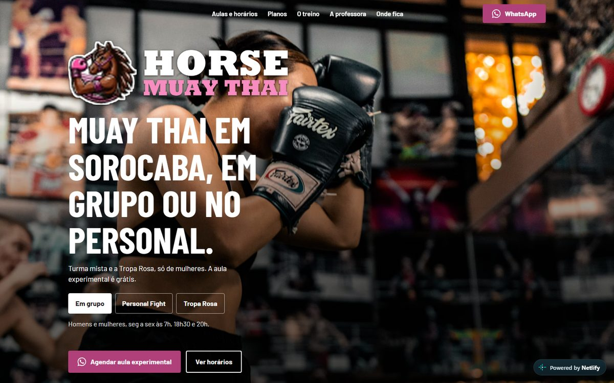

# Fábrica de sites de nicho

Gerador de landing pages para negócios locais. Cada estilo visual é um template HTML, e cada cliente tem seu arquivo de configuração. Um comando gera a página pronta para publicar, com SEO, links de WhatsApp e layout pensado primeiro para o celular.

Com ele publiquei **20 sites de academias de luta** em cidades de SP, MG e CE (jiu-jitsu, muay thai, boxe, karatê, taekwondo, krav maga, kung fu, hapkido, MMA). Cada um tem identidade própria, feita a partir do logo do cliente. Os sites são prévias de prospecção: o que o cliente ainda não confirmou (horário, preço) aparece marcado como exemplo.

| Computador | Celular |
|---|---|
|  |  |

**No ar (estilo D, Cloudflare):** [zangief-team](https://zangief-team.tayson-team.workers.dev) · [tayson-team](https://tayson-team.tayson-team.workers.dev) · [caveirinha-jiu-jitsu](https://caveirinha-jiu-jitsu.tayson-team.workers.dev) · [ct-guarulhos-karate](https://ct-guarulhos-karate.tayson-team.workers.dev)

**No ar (Netlify):** [studio-aura-jiu-jitsu](https://studio-aura-jiu-jitsu.netlify.app) · [kiritsu-dojo-karate](https://kiritsu-dojo-karate.netlify.app) · [multi-fight-ms](https://multi-fight-ms.netlify.app) · [koransel-muay-thai](https://koransel-muay-thai.netlify.app) · [horse-muay-thai](https://horse-muay-thai.netlify.app) · [ct-acacio-karate](https://ct-acacio-karate.netlify.app) · [bukan-krav-maga](https://bukan-krav-maga.netlify.app) · [kung-fu-taishan-cotia](https://kung-fu-taishan-cotia.netlify.app) · [stilos-fighter-hapkido](https://stilos-fighter-hapkido.netlify.app) · [team-kamikaze-fight](https://team-kamikaze-fight.netlify.app) · [bareia-jiu-jitsu](https://bareia-jiu-jitsu.netlify.app) e mais 5

| Estilo C | |
|---|---|
|  |  |

## Problema

Fazer um site sob medida para cada prospect leva dias. Para prospectar academias em volume, eu precisava sair do logo do cliente para um site publicado em menos de uma hora, sem que os sites parecessem todos iguais.

## Como funciona

```
base/
  estilo-d.html      template "Jornada", padrão de todo cliente novo (GSAP + ScrollTrigger + Lenis)
  estilo-c.html      template "loja/estúdio" (clientes antigos)
  estilo-a.html      template "comércio de bairro"
  gerar.js           injeta o CONFIG no template, gera o bloco de SEO e valida o JS
  tour.mjs           confere a página num Chrome headless via DevTools Protocol
  configs/           kit de cada nicho (serviços, textos, FAQ e fotos já conferidas)
clientes/<slug>/
  config.js          dados do cliente (nome, cores, modalidades, horários, fotos, logo)
  index.html         página final gerada
```

```bash
node base/gerar.js clientes/zangief-team/config.js clientes/zangief-team/index.html
node base/tour.mjs http://127.0.0.1:5216/ 390 844 m 0,900,1500
# medidas: {"scrollW":390,"innerW":390,...}   ritmo: {"fps":61,"letrasParadas":0}   erros: nenhum
```

### Estilo D, "Jornada"

O template mais novo transforma a página numa sequência guiada pela rolagem:
- as letras do título sobem e o hero afunda;
- o manifesto fica preso na tela e acende palavra por palavra;
- a cor de fundo muda por seção, seguindo as faixas da arte marcial ou os tons do logo do cliente (`jornada`);
- no computador, as modalidades correm na horizontal.

Sem CDN ou com `prefers-reduced-motion`, tudo aparece parado e legível.

## Decisões que valeram a pena

- **Configuração separada do template.** Todo texto visível vem do `config.js`. Quando melhoro o template, regero as páginas sem tocar nos dados de nenhum cliente. Recurso novo entra como campo opcional (ex.: `contato.link`, `semFiltro`), e eu confiro com `diff` que os outros clientes saem idênticos.
- **SEO estático gerado no build.** O preview de link no WhatsApp não executa JavaScript, então `gerar.js` escreve `title`, `description` e Open Graph direto no HTML a partir do config.
- **Validação antes de salvar.** O gerador extrai os `<script>` da página e compila com `new Function`, para que um erro de sintaxe no config não chegue ao ar.
- **Conferência automática em vez de olhômetro.** O `tour.mjs` abre a página em 390, 375 e 1366 px e mede várias coisas: rolagem lateral (`scrollW` igual à largura), se o fim do hero cabe acima da barra fixa, fps durante a rolagem, letras de animação travadas e erros de console. Ele também tira prints em cada ponto. Já pegou um título que empurrava os botões 2 px para fora da tela.
- **Celular primeiro.** Barra fixa de Ligar/WhatsApp, hero em `100svh` e chips que trocam a foto de fundo, com `object-position` por foto para enquadrar imagem horizontal na tela vertical.
- **Variação por cliente.** Muda de um cliente para outro: cor da marca, logo recortado com Pillow (alpha antialiasing), fotos que nunca se repetem na mesma cidade e dados reais tirados do Instagram do cliente (endereço, grade de horários, professor).

## Stack

HTML, CSS e JavaScript puro · GSAP + ScrollTrigger + Lenis · Node.js (gerador e conferência via Chrome DevTools Protocol) · Python + Pillow (tratamento de logos) · Netlify e Cloudflare Workers (deploy com Wrangler)

Feito por [Diego de Moraes](https://www.linkedin.com/in/euudm) na [Allaska](https://github.com/euudm).
